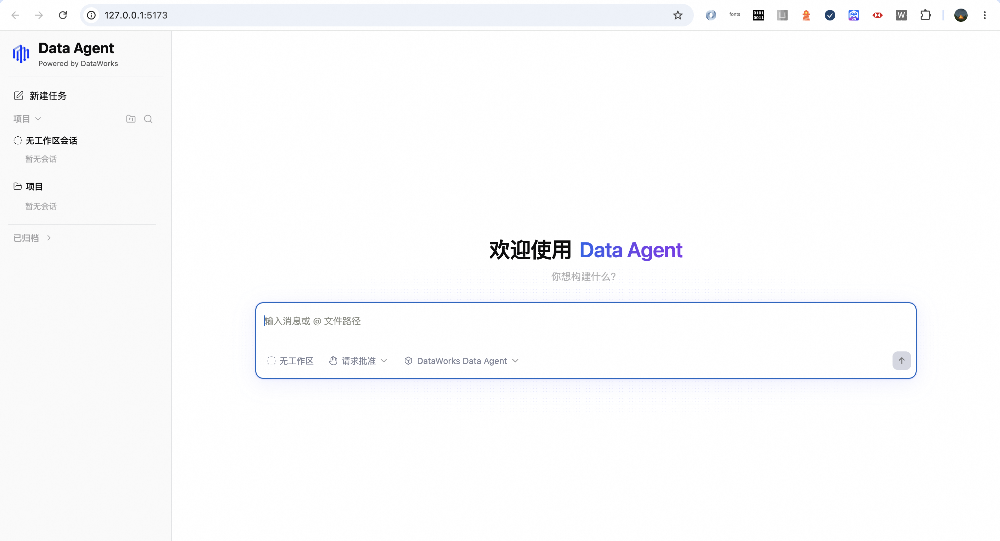

# DataAgent OpenAPI examples

[简体中文](README.md) · [GitHub](https://github.com/aliyun/alibabacloud-data-agent-openapi-examples)

Run a React web interface with your choice of Java, Python, or Node.js backend to create DataWorks DataAgent sessions, send prompts, stream responses and tool results, stop tasks, and reload history. Only one backend is needed. The repository includes synthetic demo data and does not require another repository or private package registry.



## Requirements and quick start

All options require Node.js 22.x (at least 22.12) or 24.x (22.x recommended) and npm 10+ for the frontend. Java additionally requires JDK 17+ and Maven 3.6.3+. Python requires Python 3.11+.

```bash
git clone https://github.com/aliyun/alibabacloud-data-agent-openapi-examples.git
cd alibabacloud-data-agent-openapi-examples
npm ci
npm start -- node --mock
```

Alternatively, run `npm start -- java --mock`. Java dependencies and the JAR are built on the first start.

For Python, install dependencies first:

```bash
python3 -m venv server-python/.venv
server-python/.venv/bin/python -m pip install -e ./server-python
npm start -- python --mock
```

On Windows use `py -3 -m venv server-python/.venv` and `server-python\.venv\Scripts\python.exe -m pip install -e ./server-python`.

Open the address printed in the terminal (normally <http://127.0.0.1:5173>). The launcher waits for the backend, then starts the frontend. Press Ctrl+C to stop both. Use `--mock` on all supported shells without platform-specific environment syntax. MOCK replays synthetic scenarios: responses are fixed and do not depend on your prompt. No cloud credentials or API calls are required.

## Use your own DataAgent

You need DataWorks enabled in the target region and a RAM user's AccessKey ID/secret with the necessary permissions. Start with the default official Agent, `dataworks_data_agent`; custom Agents must already be published and accessible. The ACS flow creates or reuses an instance without a resource group or ProjectId.

Copy `.env.example` to `.env` (Windows: `copy .env.example .env`) and set:

| Setting | Value |
| --- | --- |
| `MOCK` | `0` for real requests; `1` for demo replay |
| `ALIBABA_CLOUD_ACCESS_KEY_ID` | RAM user AccessKey ID |
| `ALIBABA_CLOUD_ACCESS_KEY_SECRET` | AccessKey secret; never commit it |
| `DATAAGENT_REGION_ID` | Region containing your resources, e.g. `cn-hangzhou` |
| `RESOURCE_GROUP_ID` | Leave empty for ACS; used only by the legacy resource-group flow |
| `DATAAGENT_AGENT_NAME` | Backend fallback, normally `dataworks_data_agent`; the web UI can override it |
| `END_POINT` | Optional hostname override, without protocol/path; otherwise leave empty |
| `SESSION_SOURCE` | Source marker used to list this application's sessions |

Run `npm start -- java`, `npm start -- python`, or `npm start -- node`. The backend retains credentials; the browser does not need an AccessKey. Tasks may operate on data your account can access, so verify permissions and behavior with a small task first.

## Sessions and supported interactions

The UI uses the actual `sessionId` returned by OpenAPI. Creating a session and sending a prompt updates the URL to `/session/{sessionId}` without a hash. Reloading, sharing, and browser back/forward restore the selected session. Permission and question cards send replies upstream to continue the task.

Use Session Settings in the sidebar for browser-persisted defaults for new sessions. The composer shows the locally recorded creation options for each session; unknown historic configurations are not inferred from new defaults. Existing session options are read-only.

Cloud history is reloaded when opening a session. In LIVE mode, renaming, archiving/restoring, and deleting sessions call the corresponding OpenAPI Actions; the target region must provide and authorize them. The backend does not keep a session registry or local history journal. Some UI and usage features require additional upstream capabilities. Save important results separately.

## Share over a trusted LAN

```bash
npm start -- java --lan
# Credential-free demo:
npm start -- java --mock --lan
```

Node.js and Python accept the same flags. Colleagues open the printed `http://LAN-IP:5173` address. The frontend listens on all interfaces, while the backend remains on loopback. A same-origin proxy forwards API and streaming requests, so other users do not connect to their own localhost.

Allow inbound TCP 5173 on the host firewall and ensure the network/VPN permits peers to reach the host. A shared LAN must not be assumed secure: this example has no per-user login or credential isolation. All visitors share the host account's permissions and sessions. Do not expose it directly to the internet. Use `--mock --lan` when a credential-free demonstration is sufficient. See the [README networking section](README.md#内网访问端口与配置切换) for configuration switching and troubleshooting.

## Ports, environments, and separate processes

The backend defaults to 3000 and the frontend to 5173. The launcher connects them automatically:

```bash
PORT=3100 WEB_PORT=5180 npm start -- python
DAS_ENV=demo npm start -- java
```

`DAS_ENV=demo` selects a complete `.env.demo` file, without merging `.env`. Missing selected files fail startup. Process environment variables take precedence. PowerShell: `$env:DAS_ENV="demo"; npm start -- java`; cmd: `set DAS_ENV=demo&& npm start -- java`.

To run Java and the frontend separately:

```bash
mvn -f server-java/pom.xml -DskipTests package
java -jar server-java/target/das-server-java-0.1.0.jar
# In another terminal, from the repository root:
cd web
VITE_API_BASE=http://127.0.0.1:3000 npm run dev
```

Set `MOCK=1` before launching the backend for demo mode. In PowerShell set variables using `$env:NAME="value"`; in cmd use `set NAME=value`. When launching the frontend separately, `VITE_API_BASE` must match the backend port. Restart Vite after changing it. For LAN sharing, prefer the one-command `--lan` launcher.

## Troubleshooting

- **Backend disconnected:** check startup errors, runtime prerequisites, and port conflicts. `curl http://127.0.0.1:3000/api/health` checks local health, not cloud permissions.
- **Session creation fails:** verify region, credentials, permissions, resource group, and instance availability.
- **Fixed/unrelated answers:** MOCK is a deterministic replay. Configure your account and disable MOCK for real answers.
- **Stream interrupted:** reload history before retrying. Work may still be running upstream; repeating a prompt can repeat writes.
- **Acknowledgment but no response:** check account quota, permissions, and history. Acknowledgment is not proof that a task completed.
- **Old session cannot continue:** its upstream execution binding may be unavailable. Save its results and create a new session.
- **LAN page inaccessible:** use the host's reachable IP, open the frontend port, and check VPN routing or Wi-Fi client isolation. Do not use `localhost` on a colleague's machine.

## Development and support

SDKs are pinned to Java `9.0.17`, Node.js `9.11.0`, and Python `9.11.0`; language packages have independent version numbers. See [development and validation](docs/DEVELOPMENT.md), [Node.js](server-node/README.md), [Python](server-python/README.md), and [Java](server-java/README.md) for details.

Public CI builds the frontend, runs Node/frontend tests, Python and Java tests, and all three MOCK HTTP contract checks. MOCK tests do not verify your cloud account permissions or all upstream behaviors.

See [CONTRIBUTING](CONTRIBUTING.md), [SECURITY](SECURITY.md), and [LICENSE](LICENSE). When reporting a problem, include versions and a minimal reproduction; remove credentials, business data, private endpoints, and personal information from logs.

## New and updated OpenAPI examples

See the [OpenAPI call guide](docs/OPENAPI-EXAMPLES.md) for POP Actions, exact creation fields, Node/Python/Java snippets, Events cursors, session rename/archive/delete, and administrator-only Agent examples. The optional [AssumeRole example](docs/ASSUME-ROLE.md) acquires STS credentials and launches any backend; the default startup continues to use your configured AK/SK. All three backends pass the optional security token. The example does not automatically refresh credentials.

Choose an already published Agent in **Session settings** (default: `dataworks_data_agent`). The browser saves the Agent name and keeps model/mode/reasoning defaults separate for each Agent. This only affects new sessions; existing sessions continue by their original session ID. Agent creation and publishing remain backend administrator examples.

Errors include the upstream OpenAPI `requestId` when available; the UI displays it, and Events forwards the `x-acs-request-id` response header. Local failures before a response may have no ID. Turn IDs and permission request IDs are not substituted.
